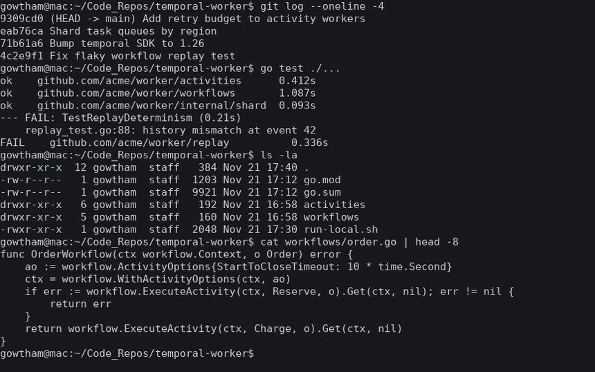
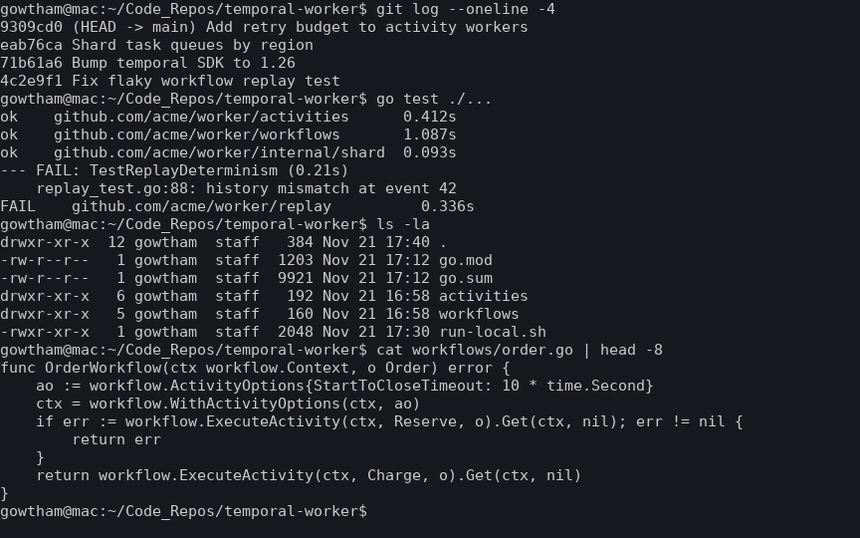
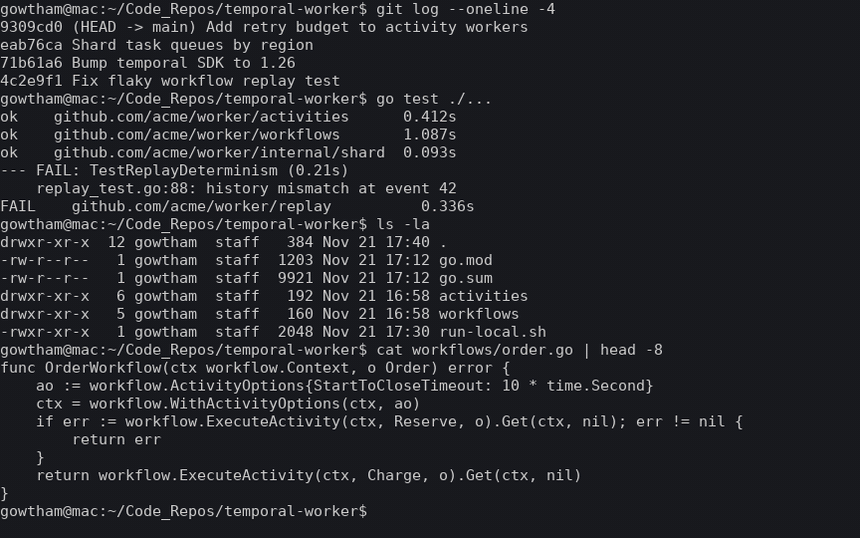

# Terminal Effects

Timed eye breaks for **macOS Terminal.app** with **zsh**. The terminal version of [vs-code-effects](https://github.com/gkannan011192/vs-code-effects).

After a set time of active work, the text in your Terminal tab falls into a black hole (or goes through a wormhole, blows up in a supernova, or turns to dust).
The screen stays empty for a short rest. Then the animation plays backward and your screen comes back exactly as it was.

It starts with every new Terminal window. There is no command to run and no key to push.



<details><summary>Wormhole</summary>



</details>

<details><summary>Supernova</summary>



</details>

<details><summary>Dust</summary>


</details>

| Effect | `BHB_EFFECT` | What it does |
|---|---|---|
| Black hole (default) | `blackHole` | A black hole opens in the middle of the window. The text spirals in, heats to orange and goes through the event horizon, nearest first. The hole collapses with a flash. On restore, the text spirals back out. |
| Wormhole | `wormhole` | The text spirals into a blue mouth (upper left), with a blue shift. After the rest, it spirals out of a second mouth (lower right). |
| Supernova | `supernova` | A star core forms and pulls the text in, then explodes: a flash, a shockwave, and the text blows outward, white-hot. A nebula fades away. On restore, the text implodes back. |
| Dust | `dust` | The text turns grey, breaks into dust and blows away to the right. Then the dust flies back. |

Nothing to install: the plugin is plain zsh, and the animation uses the JavaScript engine that is part of macOS (JavaScript for Automation, `osascript -l JavaScript`).

---

## Set up (one time)

### Requirements

| Item | Check |
|---|---|
| macOS with Terminal.app | (Applications > Utilities > Terminal) |
| zsh, the macOS default shell | `echo $SHELL` shows `/bin/zsh` |

### Procedure

1. Put the two plugin files in `~/.config/blackhole-break/`. Use one of these:
   - **Git:** clone the repository there:
     ```bash
     git clone https://github.com/gkannan011192/terminal-effects.git ~/.config/blackhole-break
     ```
   - **Download:** download `blackhole-break.plugin.zsh` and `blackhole-break.js` from this repository and save them in `~/.config/blackhole-break/`.
2. Open `~/.zshrc` in a text editor (for example: TextEdit, or VS Code). Add this line at the **end** of the file:
   ```bash
   source ~/.config/blackhole-break/blackhole-break.plugin.zsh
   ```
3. Save the file. Open a new Terminal window.

From now on, every new Terminal window and tab loads the plugin. There is nothing else to start.

The first break can show a macOS question: "Terminal wants access to control Terminal". Click **OK**. The plugin uses this access to read the visible text of the tab for the animation. If you click **Don't Allow**, the break fails. After 3 failed breaks, the plugin stops itself for that session (details in `~/.cache/blackhole-break/error.log`). To allow it later: **System Settings > Privacy & Security > Automation > Terminal**.

### Update

```bash
git -C ~/.config/blackhole-break pull
```

New windows use the new version.

### Remove

Delete the `source` line from `~/.zshrc`. Then delete the `~/.config/blackhole-break` and `~/.cache/blackhole-break` folders.

---

## Settings

All settings are optional. Put them in `~/.zshrc` **before** the `source` line:

```bash
BHB_EFFECT=blackHole                    # blackHole | wormhole | supernova | dust
BHB_INTERVAL_MINUTES=10                 # active minutes between breaks
BHB_REST_SECONDS=20                     # length of the empty-screen rest
BHB_ACTIVE_HOURS="09:00-12:30, 13:30-18:00"   # time filter; empty (default) = all day
BHB_ACTIVE_DAYS="Mon Tue Wed Thu Fri"   # day filter; default = all days
source ~/.config/blackhole-break/blackhole-break.plugin.zsh
```

| Setting | Default | Description |
|---|---|---|
| `BHB_ENABLED` | `1` | `0` turns the breaks off. |
| `BHB_EFFECT` | `blackHole` | `blackHole`, `wormhole`, `supernova` or `dust`. |
| `BHB_INTERVAL_MINUTES` | `10` | Active minutes between breaks. |
| `BHB_REST_SECONDS` | `20` | Length of the empty-screen rest. |
| `BHB_ACTIVE_HOURS` | empty (all day) | Time filter in local time, for example `09:00-12:30, 13:30-18:00`. Overnight ranges (`22:00-02:00`) are permitted. |
| `BHB_ACTIVE_DAYS` | all days | Day filter: `Mon Tue Wed Thu Fri Sat Sun`. |
| `BHB_ACTIVE_WINDOW` | `60` | After a key press, this many seconds still count as active time. |
| `BHB_IDLE_SECONDS` | `3` | A due break waits until you stop typing for this many seconds. |
| `BHB_AWAY_RESET` | `300` | No key press for this many seconds counts as a natural break: the timer starts again from zero. |
| `BHB_COMMAND_MAX_MINUTES` | `30` | Time in a running command (vim, a build) counts as active time, up to this limit. |
| `BHB_END_ON_KEY` | `1` | A key ends the break early. The key is not typed into the shell. |
| `BHB_MESSAGE` | `Rest your eyes. Look at something far away.` | Text during the rest. Empty = no text. |
| `BHB_SPEED` | `1` | Animation speed. |
| `BHB_FPS` | `30` | Frame rate. The duration does not change. |
| `BHB_HOLE_SCALE` | `1` | Size of the hole or star (0.5 - 3). It also grows with the window height. |
| `BHB_FRONT_ONLY` | `1` | A break starts only when this tab is in front. If not, the plugin tries again 30 s later. |
| `BHB_COLORS` | `256` | `256` for Terminal.app. `truecolor` for terminals that support it. |

## Optional commands

You never need these. They are shell functions that the plugin adds:

| Function | Action |
|---|---|
| `bhb-now [EFFECT]` | Take a break now (use it to see an effect). |
| `bhb-status` | Show the active time to the next break. |
| `bhb-pause [MINUTES]` / `bhb-resume` | Pause breaks (default 60 minutes) / resume. |

---

## How it works

1. **Startup.** `~/.zshrc` loads the plugin. The plugin adds hooks: a key press (zle `line-pre-redraw`), a command start (`preexec`) and a command end (`precmd`). It sets `TMOUT=1` and a `TRAPALRM` function. zsh calls `TRAPALRM` once per second, but only while the prompt waits for input. No background process runs.
2. **Timer.** All tabs share one timer in `~/.cache/blackhole-break/state`, with a file lock (`zsystem flock`):
   - Active time grows while you pressed a key in the last `BHB_ACTIVE_WINDOW` seconds, and only inside `BHB_ACTIVE_HOURS` / `BHB_ACTIVE_DAYS`.
   - A shared "last tick" makes sure that two tabs do not count the same second two times.
   - Time in a running command counts when the command ends, up to `BHB_COMMAND_MAX_MINUTES`.
   - The tab with the last key press owns the next break.
3. **Break.** When the timer is due and you stop typing, the plugin starts `osascript -l JavaScript blackhole-break.js`. The script does these steps:
   - It finds this shell's tab by its tty, and reads the visible text and the size through Terminal.app's scripting interface.
   - It switches the terminal to the alternate screen (`CSI ?1049h`), paints the text, animates, rests and animates back.
   - It switches back (`CSI ?1049l`). **Terminal.app itself** restores your screen and scrollback exactly.
   While the animation runs, the plugin waits. A key press ends the break early.
4. **Time model.** Every frame is a pure function of `t`. The clock adds real elapsed time × speed × direction. A slow frame gives fewer frames, not a longer animation. Reverse play gives an exact restore.
5. **Grains and motion.** Each character is a grain. A grain has a delay (from its distance to the hole, plus noise) and a life. A stage table holds the motion for 16 stages × 4 variants:
   - spiral in: `offset = (r·Rot(θ) − I)·v`, with `r = (1−p)^1.5` and `θ = THETA·p^1.7`;
   - supernova: `r = 1 + 5.5·p^1.3`.
   One row is 2 columns tall, so the vectors use "square" units. The hole, disk, mouths, core, shock ring and nebula are sampled 2 times per cell and drawn with half blocks (`▀ ▄ █`), for double vertical resolution. Only changed cells are written, with 256-colour codes.

## Limits

- Terminal.app gives the tab text without colours. During the animation, your text shows in one colour. After the break, the colours come back, because Terminal.app restores the screen.
- A break starts only at an idle prompt, not while a command runs. If a command runs when the break is due, the break waits for the prompt.
- The timer counts key presses, not window focus. If you read for more than `BHB_ACTIVE_WINDOW` seconds without a key press, that time does not count.
- The plugin sets `TMOUT=1` if `TMOUT` is not set. If you use `TMOUT` to log out after a time, do not use this plugin.

## Files

| File | Purpose |
|---|---|
| `blackhole-break.plugin.zsh` | The zsh plugin: hooks, shared timer, time filter, break start |
| `blackhole-break.js` | The animation (JavaScript for Automation): engine, 4 effects, 256-colour renderer |
| `tests/core.test.js` | Engine tests (`node --test`) |
| `tests/e2e_macos.py` | macOS end-to-end tests (CI): the engine under `osascript`, and the plugin in a real zsh in a pseudo-terminal |
| `media/` | Preview GIFs, recorded from the same engine in 256 colours |

## License

MIT. See [LICENSE](LICENSE).
